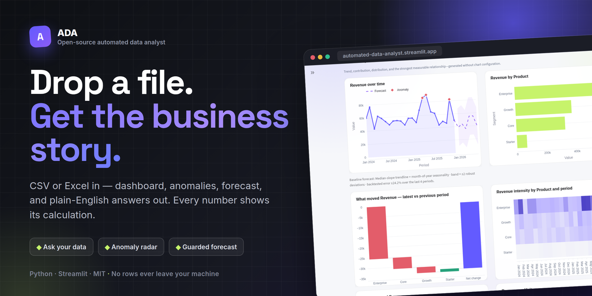
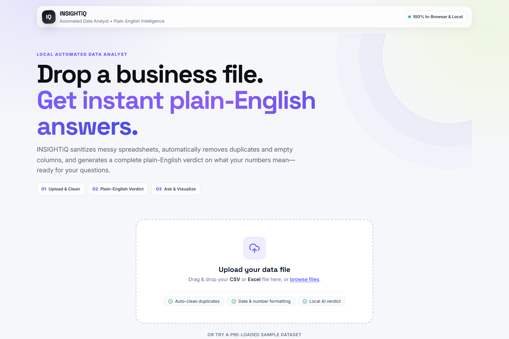
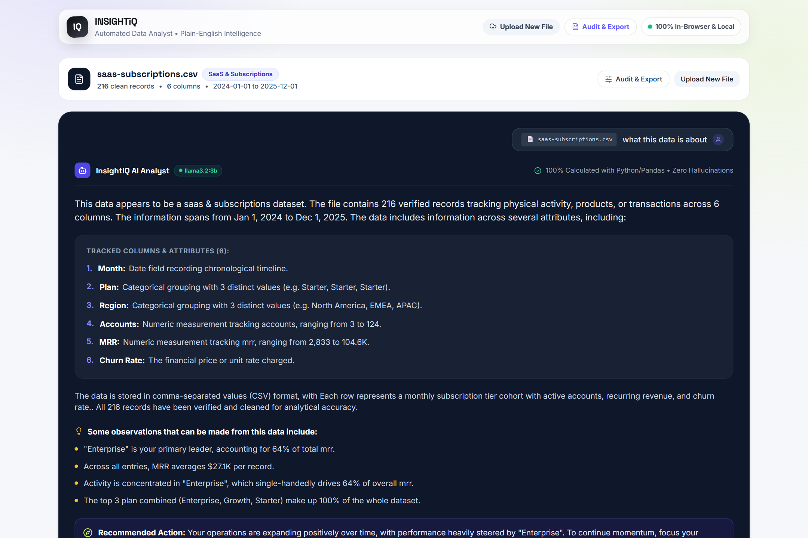
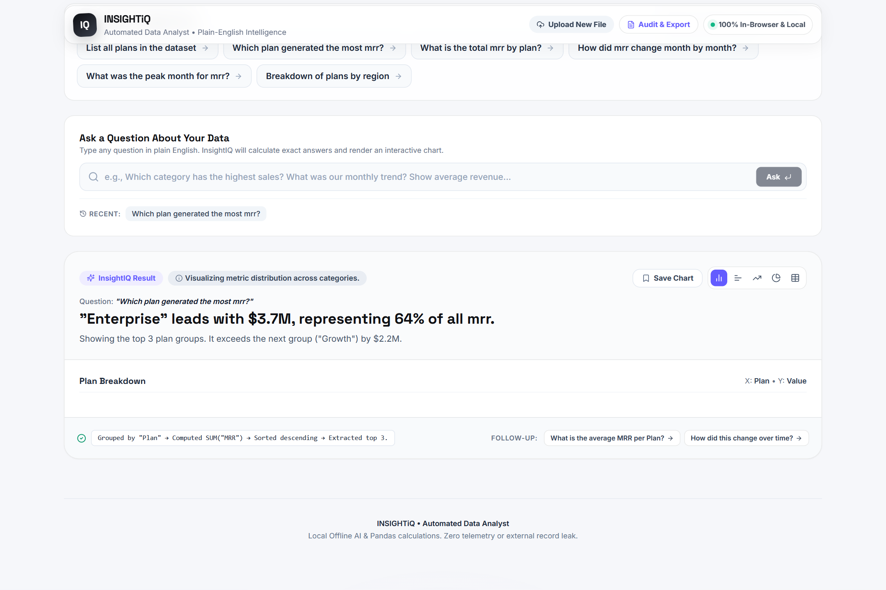
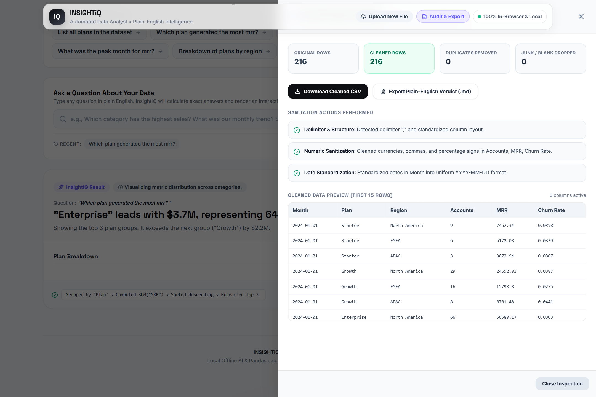
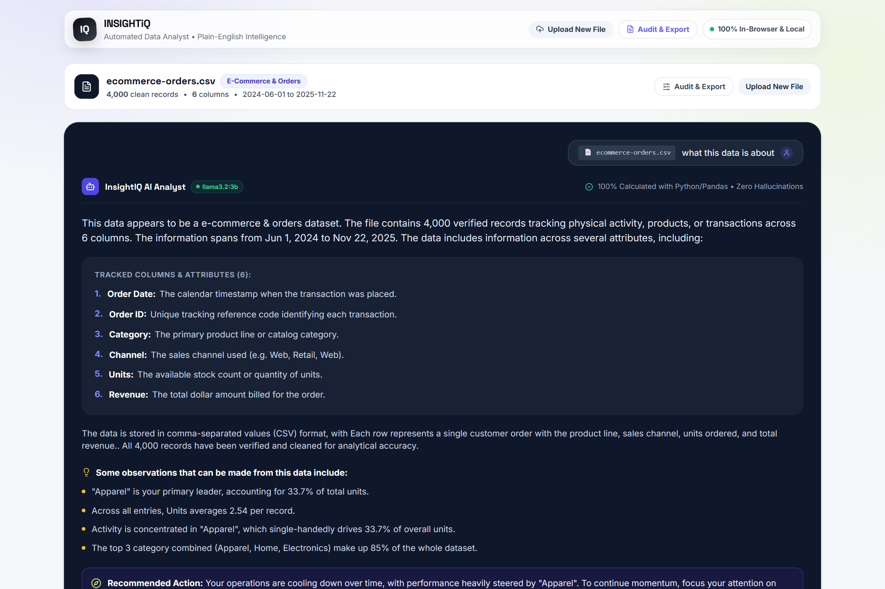
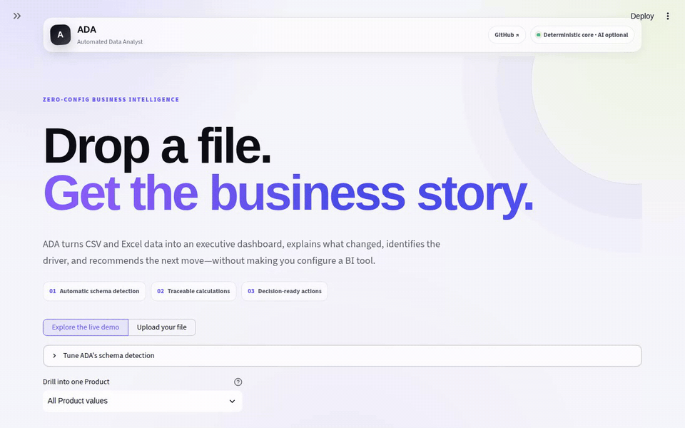
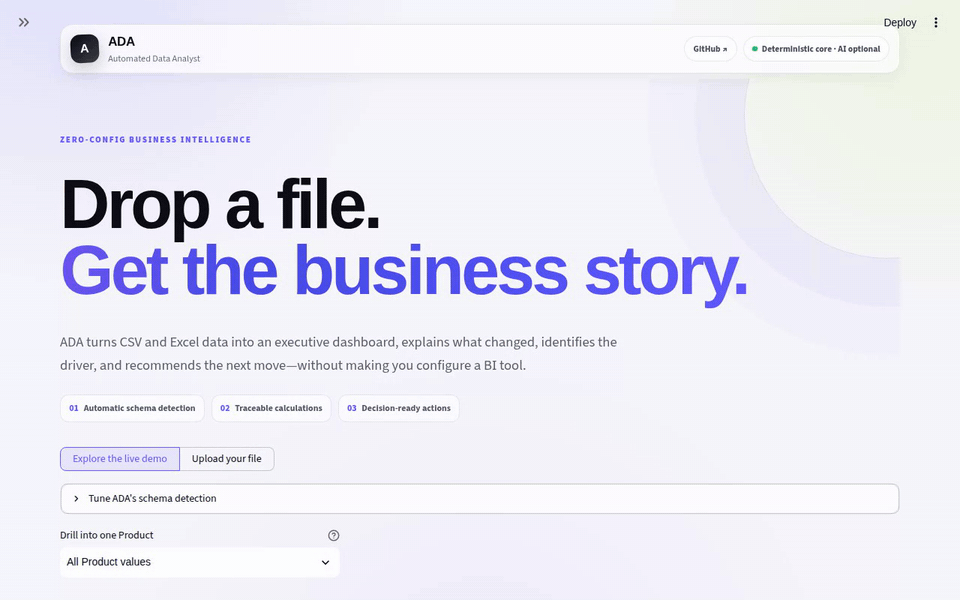
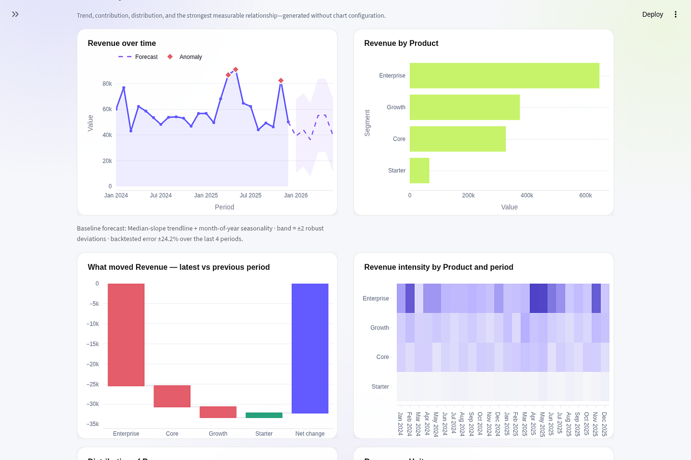
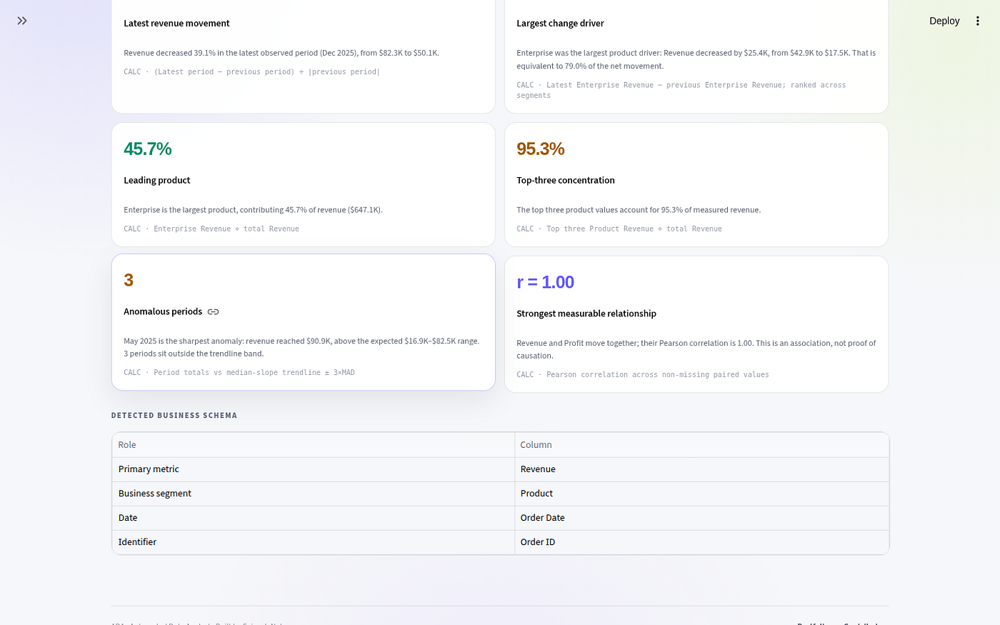

# INSIGHTiQ: Automated Data Analyst

[](https://www.python.org/)
[](https://www.typescriptlang.org/)
[](https://react.dev/)
[](https://vitejs.dev/)
[](https://tailwindcss.com/)
[](LICENSE)
[](https://github.com/anshtyagi18/Insight-IQ/stargazers)

**Upload a CSV or Excel file. Get an instant executive brief, automated data cleaning audit, calibrated anomaly flags, guarded forecast, and answers to plain-English questions — with the arithmetic calculation proven under every single number.**

[Live Demo](https://github.com/anshtyagi18/Insight-IQ) ·
[Documentation](docs) ·
[Roadmap](ROADMAP.md) ·
[Contributing](CONTRIBUTING.md)

**Repository:** [github.com/anshtyagi18/Insight-IQ](https://github.com/anshtyagi18/Insight-IQ)

> **⭐ If Insight-IQ saved you an afternoon, star the repository!**

---



---

## 📸 Visual Walkthrough & Screenshots

### 1. Upload & Auto-Cleaning Workspace
Drop any CSV, Excel, or TSV file, or launch instantly with pre-loaded sample datasets (SaaS Subscriptions, Ecommerce Orders, Support Tickets). Automatic delimiter sniffing, duplicate removal, currency normalization, and header sanitization execute 100% client-side.



---

### 2. Verified Dataset Verdict & Plain-English Briefing
Immediately upon ingestion, Insight-IQ synthesizes a plain-English executive verdict: core business domain, record count, identified primary metric, category dimensions, date spans, and top observations.



---

### 3. Interactive Analysis, Guarded Forecast & Calibrated Anomalies
Ask plain-English questions or select context-aware suggested queries. Visualized with interactive charts, movement waterfalls, trendlines, and calibrated anomaly radar indicators.



---

### 4. Transparent Data Cleaning Audit & Transformation Log
Complete visibility into every transformation: inspect duplicate rows dropped, empty columns pruned, dates normalized, and missing values handled before running analysis.



---

### 5. Multi-Domain Business Insights (Ecommerce, SaaS & Operations)
Tested across diverse business archetypes — handles SaaS recurring revenue drops, ecommerce order volume with return adjustments, and operational ticket volume distributions.



---

### 6. Dynamic Drilldowns & Plain-English NLQ (Ask ADA)

<p align="center">
  
  
</p>

<p align="center">
  
  
</p>

---

## 🚀 What it does

Insight-IQ reads your file, discovers which column is the metric, which is the date, and which is the segment, then builds the analysis around that:

- **Dashboard** — trend, segment breakdown, movement waterfall, segment × period heatmap.
- **Ask Insight-IQ** — plain-English questions answered locally with pandas/TypeScript engines, calculation shown under every figure.
- **Anomaly Flags** — periods outside a calibrated band, sized so a stable series false-alarms about once in twenty analyses.
- **Guarded Forecast** — a guarded baseline that refuses to run on thin history and reports when it was no better than assuming no change.
- **Evidence & Next Steps** — every finding carries its arithmetic formula; recommendations are labelled as interpretation, never as cause.
- **Data Audit & Exports** — full cleaning audit log, raw data preview, cleaned CSV export, and Markdown executive brief.

**File Limits**: 25 MB per file, 250,000 rows analyzed. Formats: `.csv`, `.xlsx`, `.xlsm`, `.tsv`.

---

### 📂 Pre-Loaded Sample Datasets

Pick **Try a pre-loaded sample dataset** in the app, or inspect them directly in [`samples/`](samples):

| Sample | What it shows |
|---|---|
| [SaaS subscriptions](samples/saas-subscriptions.csv) | A real revenue drop detected by the anomaly radar, and a guarded forecast that outperforms no-change |
| [Support tickets](samples/support-tickets.csv) | Non-revenue operations dataset, with a forecast honest enough to report thin history |
| [Ecommerce orders](samples/ecommerce-orders.csv) | Mixed signs and return rows, verifying robust aggregation and segment concentration |

---

## 🛠️ Run Locally

```bash
# Clone the repository
git clone https://github.com/anshtyagi18/Insight-IQ.git
cd Insight-IQ

# Install dependencies
npm install

# Start the dev server (binds to port 3000)
npm run dev

# Build for production
npm run build
```

No API key required. The app opens directly with built-in sample datasets, client-side data parsing, and full offline analysis.

---

## 🏗️ Architecture

Insight-IQ runs on modern **React 18 + Vite + TypeScript + Tailwind CSS** with client-side deterministic data processing:

- **Data Ingestion**: PapaParse (CSV/TSV) and SheetJS/XLSX (Excel) running client-side with zero remote data transfer.
- **Schema Engine**: Deterministic column role scoring (Measure, Date, Dimension, Identifier, adverse measure detection).
- **Analytics Engine**: Theil-Sen robust trendline fitting, critical multiplier-calibrated anomaly detection, guarded forecasting, and Pareto concentration analysis.
- **Visualizations**: Interactive Recharts components (Trend & Guarded Forecast, Segment Breakdown with drill-down, Movement Waterfall, and Segment × Period Matrix Heatmap).
- **Natural Language Query Engine**: Deterministic query engine showing arithmetic calculation formulas underneath every answer.
- **Data Audit & Export**: Full dataset schema summary, raw table preview, cleaned CSV download, and Markdown Executive Brief export.

---

## 🔒 Does my data leave my machine?

**No.** Cleaning, schema detection, chart rendering, and Ask Insight-IQ answers are computed locally on your device with zero network calls.

An optional AI layer can connect to a local Ollama instance (e.g. `llama3` or `mistral`) to enhance strategic summaries. Even with AI enabled, rows are never sent over the wire: only high-level summary statistics and detected column names are passed to generate narrative interpretations.

Full details: [Privacy](docs/privacy.md) · [SECURITY.md](SECURITY.md)

---

## 📚 Documentation

| Page | What you get |
|---|---|
| [Concepts](docs/concepts.md) | Definitions: measure, segment, period, evidence, plan |
| [How it works](docs/how-it-works.md) | Upload to dashboard, step-by-step |
| [Architecture](docs/architecture.md) | Architecture and component responsibilities |
| [Reference](docs/README.md#reference) | Pipeline reference and calculations |
| [Development](docs/development.md) | Setup, tests, conventions |
| [FAQ](docs/faq.md) | Common questions and troubleshooting |

---

## 🤝 Contributing

Contributions are welcome! Please read [CONTRIBUTING.md](CONTRIBUTING.md) and check out our [ROADMAP.md](ROADMAP.md).

Every new recommendation needs a test and the exact calculation formula that supports it.

---

## 📄 License

Distributed under the [MIT License](LICENSE).

Originally built with inspiration from [automated-data-analyst](https://github.com/saineshnakra/automated-data-analyst).
